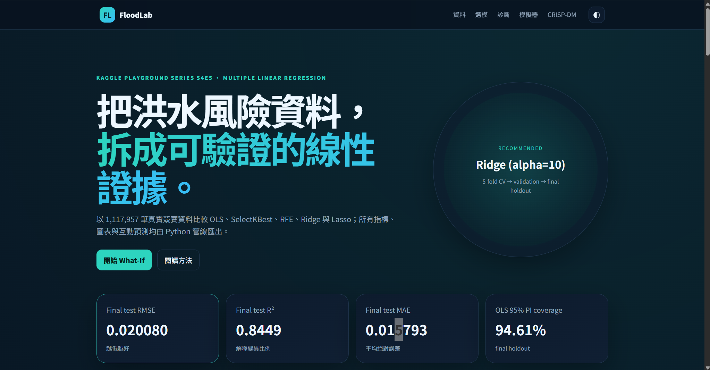

# FloodLab — Predict the Flood

「物聯網應用與資料分析」HW2：使用 Kaggle Playground Series S4E5 真實資料完成 Multiple Linear Regression、特徵選擇、模型評估、回歸診斷與互動式 GitHub Pages Dashboard。

- 學號：`5115056040`

- Repository：<https://github.com/AidenXiao0924/HW2-Predict-the-Flood>
- 預計 Pages：<https://aidenxiao0924.github.io/HW2-Predict-the-Flood/>
- 資料來源：<https://www.kaggle.com/competitions/playground-series-s4e5>

## 網站預覽

[](https://aidenxiao0924.github.io/HW2-Predict-the-Flood/)

點擊圖片即可開啟 GitHub Pages 互動式網站。

## 實際結果

資料共 1,117,957 筆有標籤樣本與 20 個數值特徵。以 `random_state=42` 建立 64/16/20 split，並在 training-only 固定 200,000-row sample 上執行 5-fold CV。候選包含 Dummy、全特徵 OLS、SelectKBest k=1..20、RFE k={5,10,15,20}、Ridge 與 Lasso。

CV 選出的推薦模型為 **Ridge (alpha=10)**：

| Metric | Final holdout |
| --- | ---: |
| MAE | 0.0157925 |
| MSE | 0.000403207 |
| RMSE | 0.0200800 |
| R² | 0.844877 |
| Adjusted R² | 0.844863 |

全 20 特徵 OLS 表現幾乎相同，並提供解析式 95% confidence/prediction intervals。Final holdout 的 OLS prediction interval coverage 為 94.61%，平均寬度為 0.07877。

## CRISP-DM

1. **Business Understanding**：預測競賽 target，不宣稱真實災害預警或因果關係。
2. **Data Understanding**：檢查 schema、缺值、id、描述統計、目標分布與相關矩陣。
3. **Data Preparation**：固定 seed；id/target 排除；所有 imputer/scaler/selector 均在 Pipeline 內。
4. **Modeling**：比較 OLS、SelectKBest、RFE、Ridge、Lasso 與 Dummy baseline。
5. **Evaluation**：MAE、MSE、RMSE、R²、Adjusted R²、殘差、DW、BP、JB、VIF、95% CI/PI。
6. **Deployment**：Python 匯出 compact JSON，純靜態網站使用相同係數完成 What-If 推論。

## 建置環境

```powershell
cd "C:\Users\AidenXiao\source\HW2-Predict-the-Flood"
python -m venv .venv
.\.venv\Scripts\python.exe -m pip install -r requirements.txt
```

Kaggle 原始資料請放入 `data/raw/`：

```text
data/raw/train.csv
data/raw/test.csv
data/raw/sample_submission.csv
```

原始 CSV 受 `.gitignore` 排除，不會提交至公開 repository。

## 重建分析

```powershell
.\.venv\Scripts\python.exe main.py
```

主要輸出：

- `outputs/figures/`：報告 PNG 圖表
- `outputs/tables/`：模型比較、係數與診斷 CSV
- `outputs/run_metadata.json`：本次執行摘要
- `web/data/`：Dashboard compact JSON/CSV

## 測試

```powershell
.\.venv\Scripts\python.exe -m pytest -q
```

測試涵蓋 schema、metrics、Pipeline leakage guard、Python/JavaScript 係數推論 parity、interval contract 與網站資產。

## 本機網站

```powershell
cd web
..\.venv\Scripts\python.exe -m http.server 8000
```

開啟 <http://localhost:8000/>。不要直接雙擊 HTML，因為瀏覽器通常會阻止 `fetch()` 讀取本機 JSON。

## GitHub Pages

`.github/workflows/deploy.yml` 會在 `main` push 後測試並發布 `web/`。Repository Settings → Pages 的 Source 需設為 **GitHub Actions**。

## 重要限制

- `FloodProbability` 是競賽目標，不代表現實世界的校準洪水機率。
- 線性係數代表關聯，不是因果效果。
- CV 為控制運算成本使用 training-only 固定抽樣；final model 仍以完整 80% development data 重訓。
- Kaggle competition test 無真實標籤，未用於本報告評估；目前未提交 Kaggle，沒有排名可報告。
- NotebookLM 原始研究與校訂版已收錄於 `report/`；GPT/Codex 原始對話 PDF 仍須由使用者依課程要求匯出。

## 繳交前待辦

- Python 繳交主程式：`5115056040_hw2.py`；最終壓縮檔請命名為 `5115056040_hw2.zip`。
- 在 `output/pdf/5115056040_hw2.pdf` 封面填寫姓名。
- 匯出 Codex 原始對話 PDF，加入繳交內容後重新建立 ZIP。
- 上傳前確認 `5115056040_hw2.zip` 的格式與檔案大小符合課程平台限制。
